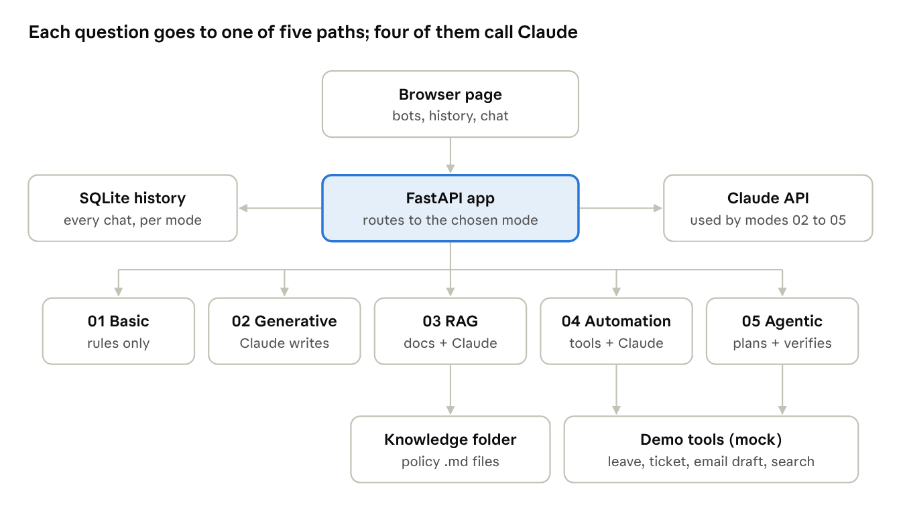

# ChatBot: Basics to Advance

**[Try it live](https://chatbot-basics-to-advance.onrender.com)** · Five working chatbots in one app, one for each stage of AI evolution, all serving the same fictional company (Bluewater Bank): **Basic rules, Generative AI, RAG, AI Automation and Agentic AI**. Ask the same question to each and see exactly what every level adds, and when it is worth using.

> More AI does not automatically mean better AI. Start with the business requirement, then choose the minimum capability needed.


## Why this project

"Chatbot", "GenAI", "RAG" and "agent" are often used as if they were the same thing, and the most advanced option is often assumed to be the best. This project makes the difference visible: each level is a real, working implementation, not a slide, and all five run side by side on the same questions.

It is part of the **Learning with Naveen** module on the evolution of AI, and was planned and delivered as a small product: charter, phases and gates, runbook, tests.

## The five levels

| # | Level | Workflow | What it adds | Best for |
| --- | --- | --- | --- | --- |
| 01 | Basic chatbot | User -> menu or rule match -> fixed response + next options | Exact, predictable answers | FAQs, regulated wording, menus |
| 02 | Generative AI | Prompt -> LLM -> generated response | Understands free text, writes new content | Drafting, summarising, explaining |
| 03 | RAG | Question -> retrieve documents -> LLM -> grounded answer | Answers from your own documents, with sources | Policies, SOPs, knowledge bases |
| 04 | AI Automation | Request -> rules pick tools -> action -> Claude summarises | Carries out defined tasks | Tickets, lookups, recurring reports |
| 05 | Agentic AI | Goal -> plan -> look, then decide and act -> verify -> result | Decides its next step from what it finds | Investigations, multi-step goals, with human approval |

Real-world examples for each level, and where each is the wrong choice, are in the [project charter, section 6.2](docs/PM004_01_Project_Charter.md#62-where-each-type-is-most-useful).

### One question, five answers

| Level | "Can I take two days of leave next week?" |
| --- | --- |
| 01 Basic | A fixed answer: leave needs approval and 5 working days' notice; no model used |
| 02 Generative AI | Sensible general advice, but it does not know Bluewater Bank's policy or your balance |
| 03 RAG | Quotes the actual leave policy with a numbered citation and the source passage |
| 04 AI Automation | Rules run the leave balance and leave policy tools (mock data); Claude summarises |
| 05 Agentic AI | Plans, looks up balance and policy, decides no action is needed and verifies; its "Why an agent here" note can say a lower level would have done |

### Choosing the level


## Reuse: an internal employee assistant

**The same bot can be rebuilt or integrated for internal employees.** Bluewater Bank's customers are the demo audience, but the five-level design works just as well as an employee assistant: pointed at internal HR and policy documents and internal systems, it lets staff check leave and other policies and send out emails.

| Level | For employees, it would… |
| --- | --- |
| 01 Basic | Answer fixed HR and IT FAQs: holidays, office hours, how to request leave |
| 02 Generative AI | Help draft emails, messages and summaries |
| 03 RAG | Answer leave, travel, expense and IT policy questions from the company's own policies, with the policy cited |
| 04 AI Automation | Check a leave balance, raise an HR or IT ticket, draft an email to a manager for review |
| 05 Agentic AI | Handle goals such as "Plan two days off next week and draft the request": check balance, notice rule and team calendar, then ask the employee to approve before anything is sent |

The demo already contains the employee side as mock tools (leave balance, leave policy, email drafts), so moving to internal use means swapping in the company's documents and connecting the HR system, ticketing tool and email, behind company sign-in, with human approval kept before anything is sent or submitted.

## How it works



- **01 Basic:** a guided menu of fixed questions; each answer offers the next questions as buttons, and typed questions are matched by keyword. Never calls an AI model.
- **02 Generative AI:** sends the conversation to Claude with a short system prompt.
- **03 RAG:** keyword retrieval (common words ignored) over the Markdown files in `knowledge/`; Claude answers only from the retrieved passages and cites them with numbered markers, and a Sources list under the answer shows each document's title and the exact passage used. If nothing matches, it says so and Claude is not called.
- **04 AI Automation:** fixed rules choose allow-listed demo tools (leave balance, leave policy, knowledge search, ticket, email draft, block card, order replacement card, payment status); Claude summarises the results. If no rule matches, it falls back to the level 03 document search and answers with numbered citations. Actions that cannot be undone (blocking a card) pause for the user's **Yes / No** approval first, and follow-up buttons offer only real tasks on the same topic (for example, after a card block: order a replacement card or raise a card ticket).
- **05 Agentic AI:** a visible **Plan -> Act -> Verify** workflow on every answer, with a plain-language "Why an agent here" note (which honestly says when a simpler level would have done). Act is a look -> decide loop. Claude plans and runs **read-only lookups** first, sees what they returned, then **decides** whether any action (ticket, email, card) is really needed. The app runs only allow-listed tools and holds any irreversible step until the user approves it. The reply is short and customer-facing; the plan, lookups, decision and check appear in "What this level did".
- **History:** every conversation is stored per mode in SQLite and can be reopened, including what each level did.
- **Shared company:** all five bots use the same fictional company, Bluewater Bank: the Basic menu, the five knowledge files and the demo tools state the same facts, so answers can be compared like for like.
- **Same workflow in every bot:** all five open with the same five topics (Banking hours, Branches and ATMs, Cards, Leave policy, Write an email), and each topic opens the same short list of questions in every bot; nothing is sent until you pick one, so levels can be compared like for like. Every answer ends with follow-up buttons plus Main menu: fixed in levels 01 and 04, suggested by Claude in 02, 03 and 05. In 05 each topic also offers a gold **agent goal**, and a "Goals for the agent" strip stays above the message box.
- **Transparency:** under every AI answer, a "What this level did" panel shows the sources used, tools run (with their mock results), blocked tools, the agent's decision and checks, and the **cost**: Claude calls and input/output tokens per step.
- **Honest errors:** if Claude cannot be reached, the chat says why in plain words (invalid key, missing workspace ID, no credit, no internet) and how to fix it, with an Open Settings button.

## Quick start

**Live demo:** https://chatbot-basics-to-advance.onrender.com (Render free plan: the first visit may take up to a minute while it wakes up; AI answers are capped per day).


**Windows**
1. Install Python 3.10+ (tick "Add Python to PATH").
2. Double-click `run_windows.bat`.
3. First run only: paste your Anthropic API key (and workspace ID if your key needs one). It is saved to a local `.env` file.
4. The browser opens http://127.0.0.1:8000. The badge at the top right shows whether Claude is really connected; click **Settings** to change the key, workspace ID or model and run a live connection test.

**macOS / Linux**
```bash
pip install -r requirements.txt
cp .env.example .env    # then add your ANTHROPIC_API_KEY
uvicorn app:app --reload
```

Full setup, a demo script and troubleshooting are in the [runbook](docs/PM004_04_Runbook.md).

## Tests

```bash
pip install -r requirements-dev.txt
pytest
```

The 36-test suite covers all five modes offline: Claude is replaced by a fake client, so no API key, internet or credit is needed. It checks that Basic never calls the model, RAG cites sources, drops weak matches and refuses off-topic questions, only allow-listed tools ever run, a card is never blocked without a Yes, the agent looks before it acts and shows Plan / Act / Verify, token use is recorded and history is capped, settings never return the key, the hosted demo keeps each visitor's chats private and enforces daily caps, and key, workspace and credit problems produce plain-English fixes. Tests run automatically on every push (GitHub Actions).

## Project structure

```
app.py                 FastAPI server: five modes, tools, retrieval, history, Claude calls
static/index.html      Three-column web page
knowledge/             Demo documents for RAG (add your own .md files)
tests/                 Offline test suite
docs/                  Project charter, runbook and diagrams
run_windows.bat        One-click start on Windows
.env.example           Settings template (copy to .env; never commit .env)
```

## Project documents

Start with the executive summary; each document opens with its main point in one sentence.

| Document | What it covers |
| --- | --- |
| [PM004_05 Executive Summary](docs/PM004_05_Executive_Summary.md) | One page: the problem, what was built, business cases for each level, how to choose, status, my role |
| [PM004_01 Project Charter](docs/PM004_01_Project_Charter.md) | Problem, objectives, scope, the five levels with real-world examples, architecture, phases and gates, risks |
| [PM004_02 Lifecycle Framework](docs/PM004_02_Lifecycle_Framework.md) | Six stages per phase and release, gate results G0 to G4, UAT-then-Prod release flow, document register |
| [PM004_03 Project Plan](docs/PM004_03_Project_Plan.md) | WBS, schedule with actual dates and critical path, cost, quality plan, risk heat map, baseline |
| [PM004_06 Workflows](docs/PM004_06_Workflows.md) | Functional (user view) and technical workflows, error and safety paths, API and data |
| [PM004_07 Token Optimisation](docs/PM004_07_Token_Optimisation.md) | Where the tokens go, ten techniques used here, measured cost per level, what to add at scale, and a checklist for every project |
| [PM004_09 Presentation (PDF)](docs/PM004_09_Presentation.pdf) | 9-slide overview: the problem, one slide per level (how it works, best for, watch out, cost), how to choose, built for live use |
| [PM004_10 Evaluation](docs/PM004_10_Evaluation.md) | Live run of the same questions through all five levels: answers, defects, tokens, cost and time |
| [PM004_04 Runbook](docs/PM004_04_Runbook.md) | Setup, daily use, demo script, troubleshooting, extending safely |
| [Changelog](CHANGELOG.md) | What changed and when |

## Roadmap


Next: live verification of all five modes with a shared scenario set, then Claude native tool use for levels 04 and 05 and stronger retrieval for level 03.

## Guardrails

**Guardrails are built in, enforced in code and covered by tests; they are not left to the prompt alone.** These are the controls that keep a live AI system safe, grounded and affordable.

| Type | Guardrail in this app |
| --- | --- |
| Input | Message length limit on the public demo; empty messages and unknown bots rejected |
| Grounding | RAG answers only from retrieved passages, cites each one, and refuses when nothing relevant is found; weak matches are dropped |
| Action | Tool allow-list; read-only tools run first and actions only after the decision step; Yes / No approval before anything irreversible; a No runs nothing |
| Safe failure | If the agent's plan or decision cannot be read, it takes no action and shows the raw reply |
| Scope | The agent may not widen the user's goal or raise tickets the documents already answer |
| Cost and abuse | Daily caps on Claude calls (whole app and per visitor), history cap, output token caps |
| Security and privacy | API key only on the server; Settings locked on the public demo; each visitor sees only their own chats; demo data and mock tools only |
| Transparency | "What this level did" shows sources, tools, decision, checks and cost for every answer |

**Not built yet (next for any live use):** prompt-injection checks on document text, masking of personal data before it reaches the model, moderation of inputs and outputs, and an automated evaluation set.

## Scope and safety

- Learning prototype with demo data only. Not production software.
- Demo tools are mock: nothing is emailed, submitted, booked or changed outside the app.
- Human in the loop: irreversible actions (blocking a card) never run until the user approves them, in both Automation and Agentic modes.
- The API key stays on the server side in `.env`, which is excluded from git.
- Production use would also need authentication, access control, the guardrail gaps listed above, monitoring and a security review.

## Tech stack

Python, FastAPI, SQLite, Anthropic Claude API (Sonnet by default), vanilla HTML/CSS/JavaScript, pytest, GitHub Actions.

## Author

**Naveen Nigam** · Product Owner, Project Manager and AI Consultant · PMP
[LinkedIn](https://www.linkedin.com/in/naveen-nigam-90193ab/)

## Licence

[MIT](LICENSE)
