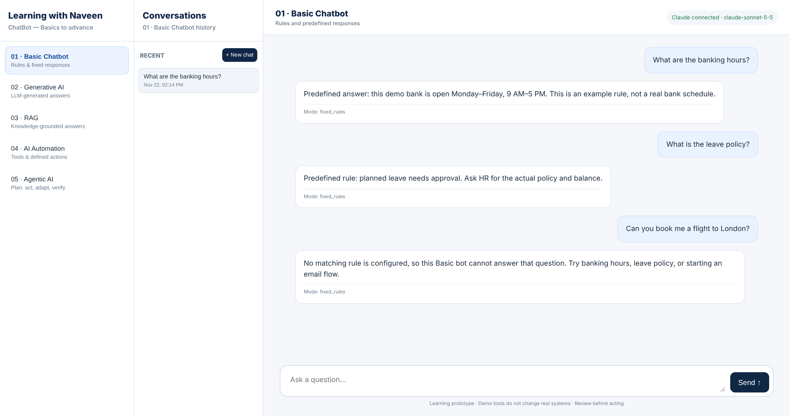
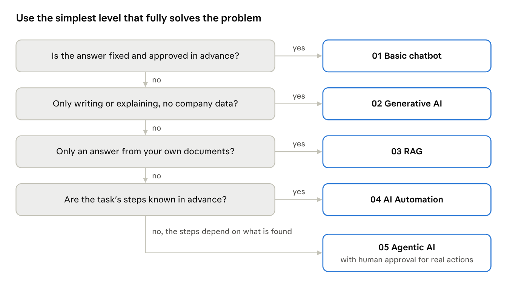
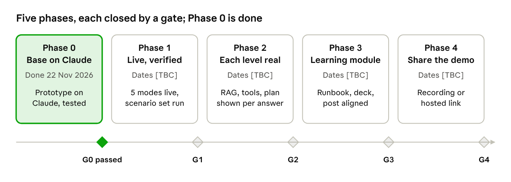

# ChatBot: Basics to Advance

Five working chatbots in one app, one for each stage of AI evolution: **Basic rules, Generative AI, RAG, AI Automation and Agentic AI**. Ask the same question to each and see exactly what every level adds, and when it is worth using.

> More AI does not automatically mean better AI. Start with the business requirement, then choose the minimum capability needed.



## Why this project

"Chatbot", "GenAI", "RAG" and "agent" are often used as if they were the same thing, and the most advanced option is often assumed to be the best. This project makes the difference visible: each level is a real, working implementation, not a slide, and all five run side by side on the same questions.

It is part of the **Learning with Naveen** module on the evolution of AI, and was planned and delivered as a small product: charter, phases and gates, runbook, tests.

## The five levels

| # | Level | Workflow | What it adds | Best for |
| --- | --- | --- | --- | --- |
| 01 | Basic chatbot | User -> rule match -> fixed response | Exact, predictable answers | FAQs, regulated wording, menus |
| 02 | Generative AI | Prompt -> LLM -> generated response | Understands free text, writes new content | Drafting, summarising, explaining |
| 03 | RAG | Question -> retrieve documents -> LLM -> grounded answer | Answers from your own documents, with sources | Policies, SOPs, knowledge bases |
| 04 | AI Automation | Request -> LLM -> tool -> action -> result | Carries out defined tasks | Tickets, lookups, recurring reports |
| 05 | Agentic AI | Goal -> plan -> tools -> observe -> verify -> result | Works out the steps towards a goal | Investigations, multi-step goals, with human approval |

Real-world examples for each level, and where each is the wrong choice, are in the [project charter, section 6.2](docs/PM004_01_Project_Charter.md#62-where-each-type-is-most-useful).

### One question, five answers

| Level | "Can I take two days of leave next week?" |
| --- | --- |
| 01 Basic | Answers only if that exact rule was programmed; otherwise a fallback |
| 02 Generative AI | A sensible general answer, but does not know the company's policy |
| 03 RAG | Quotes the actual leave policy and cites the file |
| 04 AI Automation | Also checks the leave balance and prepares the request |
| 05 Agentic AI | Checks policy, balance and calendar, suggests dates, verifies, asks before submitting |

### Choosing the level



## How it works


- **01 Basic:** keyword rules in Python; never calls an AI model.
- **02 Generative AI:** sends the conversation to Claude with a short system prompt.
- **03 RAG:** keyword retrieval over Markdown files in `knowledge/`; Claude answers only from the retrieved text and cites the file. If nothing matches, it says so instead of guessing.
- **04 AI Automation:** keyword rules choose allow-listed demo tools (leave balance, leave policy, knowledge search, ticket, email draft); Claude summarises the results.
- **05 Agentic AI:** Claude writes a short plan and picks tools; the app runs only allow-listed tools; Claude explains the results and verifies them.
- **History:** every conversation is stored per mode in SQLite and can be reopened.

## Quick start

**Windows**
1. Install Python 3.10+ (tick "Add Python to PATH").
2. Double-click `run_windows.bat`.
3. First run only: paste your Anthropic API key (and workspace ID if your key needs one). It is saved to a local `.env` file.
4. The browser opens http://127.0.0.1:8000.

**macOS / Linux**
```bash
pip install -r requirements.txt
cp .env.example .env    # then add your ANTHROPIC_API_KEY
uvicorn app:app --reload
```

Full setup, a demo script and troubleshooting are in the [runbook](docs/PM004_04_Runbook.md).

## Tests

```bash
pip install -r requirements-dev.txt
pytest
```

The suite covers all five modes offline: Claude is replaced by a fake client, so no API key, internet or credit is needed. It checks that Basic never calls the model, RAG cites sources and refuses when nothing matches, only allow-listed tools ever run, history is saved, and failed requests recover cleanly. Tests run automatically on every push (GitHub Actions).

## Project structure

```
app.py                 FastAPI server: five modes, tools, retrieval, history, Claude calls
static/index.html      Three-column web page
knowledge/             Demo documents for RAG (add your own .md files)
tests/                 Offline test suite
docs/                  Project charter, runbook and diagrams
run_windows.bat        One-click start on Windows
.env.example           Settings template (copy to .env; never commit .env)
```

## Project documents

| Document | What it covers |
| --- | --- |
| [PM004_01 Project Charter](docs/PM004_01_Project_Charter.md) | Problem, objectives, scope, the five levels with real-world examples, architecture, phases and gates, risks |
| [PM004_04 Runbook](docs/PM004_04_Runbook.md) | Setup, daily use, demo script, troubleshooting, extending safely |
| [Changelog](CHANGELOG.md) | What changed and when |

## Roadmap



Next: live verification of all five modes with a shared scenario set, then Claude native tool use for levels 04 and 05 and stronger retrieval for level 03.

## Scope and safety

- Learning prototype with demo data only. Not production software.
- Demo tools are mock: nothing is emailed, submitted, booked or changed outside the app.
- The API key stays on the server side in `.env`, which is excluded from git.
- Production use would need authentication, access control, rate limits, guardrails, human approval for actions, monitoring and a security review.

## Tech stack

Python, FastAPI, SQLite, Anthropic Claude API (Sonnet by default), vanilla HTML/CSS/JavaScript, pytest, GitHub Actions.

## Author

**Naveen Nigam** · Product Owner, Project Manager and AI Consultant · PMP
[LinkedIn](https://www.linkedin.com/in/naveen-nigam-90193ab/)

## Licence

[MIT](LICENSE)
