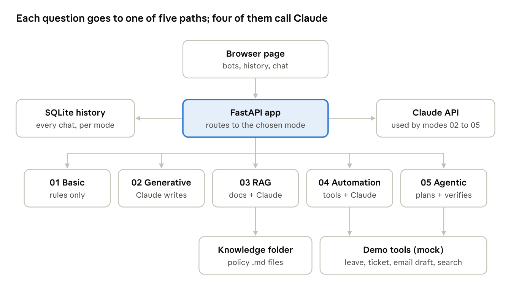
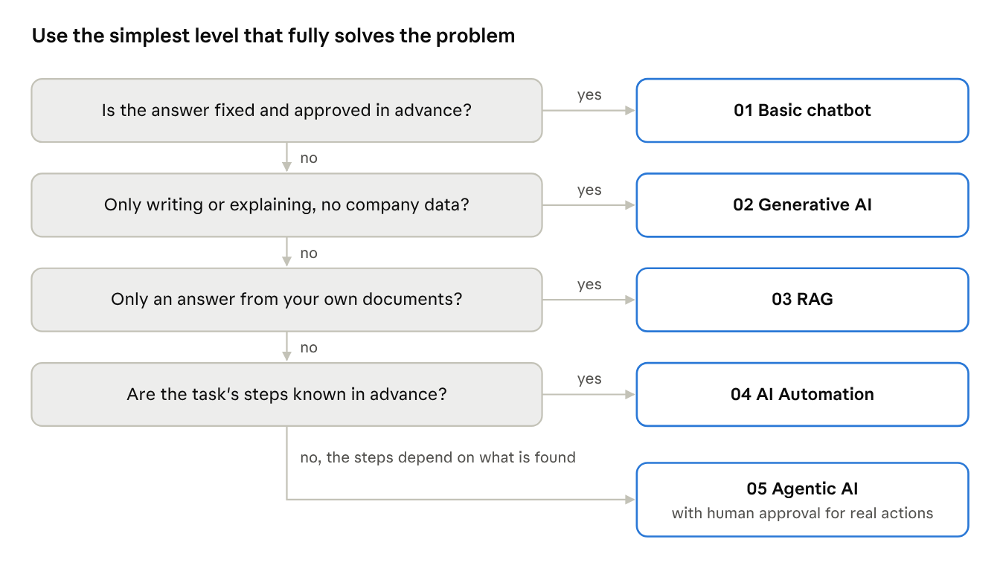
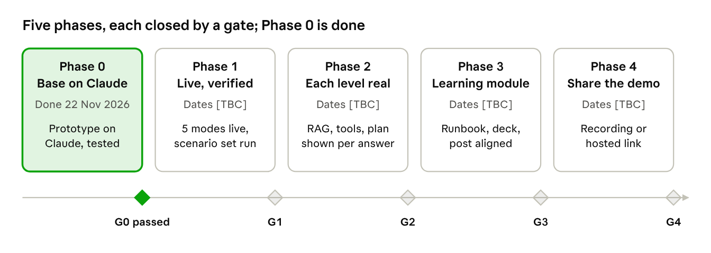

# PM004_01 Project Charter: ChatBot - Basics to Advance

22 Nov 2026 · Naveen Nigam · v0.1, Draft

**Charter at a glance**

- **Vision:** One working app where the same question goes through five chatbot types (Basic, Generative AI, RAG, AI Automation, Agentic AI), so anyone can see what each level adds and when it is worth using.
- **Objectives:** (1) all five types answer live questions on Claude and save every conversation in the history panel; (2) one shared set of business scenarios is run through all five and the differences recorded; (3) a short learning module explains where each type fits.
- **MVP:** the prototype running on Claude, five modes working, history saved, scenario set run end to end.
- **Key date:** started 22 Nov 2026; target completion [TBC].

The guiding idea: more AI does not automatically mean better AI. Start with the business requirement, then choose the minimum capability needed.

## 1. Project overview

PM004 turns the "ChatBot - Basics to Advance" prototype into five working chatbots that show, side by side, how AI evolved from fixed rules to goal-driven agents.

**Why now.** The learning material already existed: a five-level roadmap, real-world examples, a slide deck and a LinkedIn post. What was missing was a version where each level actually does its job instead of simulating it. The prototype was moved from OpenAI to Claude on 22 Nov 2026.

| Item | Detail |
| --- | --- |
| Project name | ChatBot - Basics to Advance |
| Project code | PM004 |
| Owner and project manager | Naveen Nigam |
| Organisation | Learning with Naveen |
| Version and status | v0.1, Draft |
| Planned start | 22 Nov 2026 |
| Planned end | [TBC] |
| Working base | This repository (FastAPI, SQLite, Claude) |

## 2. Problem statement and pain points

People hear "chatbot", "GenAI", "RAG" and "agent" used as if they were the same thing, or assume the most advanced option is always the best, and nothing they can try shows them the difference.

Baselines are placeholders to confirm once the scenario set has been run.

| # | Pain point | Where it hurts | Impact | Baseline |
| --- | --- | --- | --- | --- |
| P1 | Earlier HTML versions only simulated each level; none called an LLM, retrieved a document or ran a tool | Learning module, credibility of the demo | Learners read about the difference instead of seeing it | [x] of 5 levels working for real |
| P2 | "More advanced AI is always better" is the common assumption | Developers, managers, clients | Over-built, costly or risky solutions where a simpler one would do | [TBC] |
| P3 | Each level was shown with different examples, so outputs could not be compared | Learning module | The real difference between levels is hard to see | [x] scenarios run across all 5 |
| P4 | Prototype depended on an OpenAI key, while the working key is Anthropic | Running the demo | Prototype could not be run as delivered | Resolved 22 Nov 2026 |
| P5 | Material was spread across several tools and folders | Keeping the module current | Versions drift | [TBC] |
| P6 | Consultant-level topics (prompting, RAG mechanics, tool calling, guardrails, evaluation) not yet covered | Depth of the module | Gaps when explaining choices to a client | Not measured |

**Cost of doing nothing.** The module stays a set of descriptions and simulated screens, and the core message (choose the right setup, not the biggest one) has nothing working behind it.

## 3. Why this option was selected

Building on the existing Python prototype, moved to Claude, was chosen because it already has all five levels in one app with saved history.

| Option | Who benefits | Impact | Decision |
| --- | --- | --- | --- |
| A. Simulated HTML demos, one per level | Learners reading the module | Explains the levels but does not run them | Kept as reference only |
| B. Python prototype on OpenAI | Learners, demo audience | Real working levels, but needs an OpenAI key | Superseded by D |
| C. Rebuild as single-file desktop apps | Single desktop user | Simple to open, but drops the server, RAG files and tools | Not chosen |
| D. Same prototype, moved to Claude, design kept | Learners, demo audience, hiring managers | Real working levels; one base to extend | **Selected, 22 Nov 2026** |

## 4. Business case and objectives

A working, explainable demo of the five AI levels backs the Learning with Naveen module and shows hands-on AI product and consulting skills.

| # | Objective | Pain points | Measure | Baseline | Target |
| --- | --- | --- | --- | --- | --- |
| O1 | All five chatbots answer live questions on Claude and record every conversation | P1, P4 | Each mode returns a live answer and its chat reopens (yes/no per mode) | Offline tests pass; live key test pending | 5 of 5 |
| O2 | Each level does its defining job for real | P1 | Per-level check passes (yes/no) | [x] of 5 | 5 of 5 |
| O3 | One shared scenario set shows the difference between levels | P2, P3 | Scenarios run through all 5 modes, outputs captured side by side | 0 | [TBC] (proposed: 5) |
| O4 | Learners can pick the right level for a problem | P2, P6 | Learning module published (this charter, deck, runbook) | Deck and post drafted | Published [TBC] |
| O5 | One source of truth | P5 | All current material in this repository (yes/no) | Spread across tools | 1 place |

| Baseline metric | Placeholder baseline | Target | Expected saving |
| --- | --- | --- | --- |
| Time for a new user to install and get the first live answer on Windows | [x] min | [y] min | [z]% = (x - y) / x |
| Time to run the full scenario set through all 5 modes | [x] min | [y] min | [z]% = (x - y) / x |

## 5. Scope

One app with five working levels and the material that explains them. All boundaries are proposed.

**In scope**
- The five modes: 01 Basic, 02 Generative AI, 03 RAG, 04 AI Automation, 05 Agentic AI
- Claude for modes 02 to 05; Basic stays rules only
- Conversation history per mode in SQLite
- RAG over Markdown files in `knowledge/`, with source file names shown
- Allow-listed demo tools (leave balance, leave policy, knowledge search, ticket, email draft) that change nothing outside the app
- One shared scenario set run through all five modes
- Learning content: this charter and the runbook (PM004_04)

**Out of scope**
- Real external actions: sending email, submitting leave, creating real tickets, bookings
- Production deployment, user accounts and authentication
- Fine-tuning a model
- Deep teaching of embeddings, vector databases, evaluation and observability

**Backlog (parked)**
- Embedding-based retrieval with a vector store for mode 03
- Claude native tool use for modes 04 and 05 instead of keyword rules and a JSON plan
- Memory beyond the current conversation
- Guardrails, human approval step in the UI, evaluation set, cost and token display
- One question sent to all five modes at once, answers side by side
- Hosted demo link

**MVP**
- **Must:** five modes answer live on Claude; history saved and reopened; scenario set run and captured; runbook
- **Should:** sources, tools and plan visible under each answer; custom documents in `knowledge/`
- **Could:** side-by-side compare view; transcript export; hosted link

## 6. Solution overview

One local web app lets the user pick one of five chatbots; each question goes to that chatbot's own logic, modes 02 to 05 call Claude, and every conversation is saved.

The browser talks only to the local app; the app saves every message, sends it to the selected mode, and only modes 02 to 05 reach Claude over the internet.

### 6.1 The five types at a glance

Each level keeps what the previous one could do and adds one capability: rules, then generation, then grounded knowledge, then actions, then goal-driven orchestration.

| # | Type | Workflow | What it adds | In the prototype today |
| --- | --- | --- | --- | --- |
| 01 | Basic chatbot | User -> menu or rule match -> predefined response | Fixed, predictable answers | Guided menu of 16 demo topics (bank hours, branches, cards, leave, email templates) with follow-up buttons; falls back to the main menu |
| 02 | Generative AI | Prompt -> LLM -> generated response | Understands free text and writes new content | Claude with a short system prompt |
| 03 | RAG | Question -> retrieve knowledge -> LLM -> grounded answer | Answers from your own documents, with sources | Keyword retrieval over 3 demo policy files; refuses when nothing matches |
| 04 | AI Automation | Request -> LLM -> tool or API -> action -> result | Does defined tasks through tools | Keyword rules call allow-listed demo tools; Claude summarises results |
| 05 | Agentic AI | Goal -> plan -> tools -> observe and adapt -> verify -> result | Works out the steps itself towards a goal | Claude writes a plan, picks allowed tools, the app runs them, Claude explains and verifies |

These are not five separate products. In real systems they combine: an agent often uses RAG, tools and memory together. The levels are a way to learn which capability a problem actually needs.

### 6.2 Where each type is most useful

The right level is the simplest one that fully solves the problem. Examples are illustrative, from banking, payments operations, HR, IT service desk and everyday work.

#### 01 Basic chatbot: when the answer must be exact and never changes

| Example | Who uses it | Why this level fits |
| --- | --- | --- |
| Branch hours, holiday list, cut-off times for same-day payments | Bank customers | Answers are fixed and must be word-perfect |
| Menu-driven "track my order" or "block my card" options | Retail and bank customers | A short menu is faster than typing, and nothing should be guessed |
| Password-reset and "how do I log in" FAQ | Employees, IT service desk | High volume, identical answers, near-zero cost |
| Regulated disclosures and interest-rate statements | Compliance-sensitive teams | Wording is approved in advance and must not vary |

Not the right choice when questions are phrased in many ways, or need judgement or new content.

#### 02 Generative AI: when the task is to write, explain or rephrase

| Example | Who uses it | Why this level fits |
| --- | --- | --- |
| Draft a leave request, status update or reply to a client | Any employee | Needs natural writing, not company data |
| Summarise meeting notes or a long email thread | Managers, project managers | Condensing text is a core LLM strength |
| Explain a concept simply, such as ISO 20022 or Azure regions | Learners, new joiners | Explanation and analogies, no private facts needed |
| Rewrite a technical incident note in plain English | Production support | Changes tone and audience, keeps the facts given |

Not the right choice when the answer depends on your organisation's current policies or data: it may answer confidently but wrongly.

#### 03 RAG: when the answer must come from your own documents

| Example | Who uses it | Why this level fits |
| --- | --- | --- |
| "How many days' notice do I need for planned leave?" from the HR policy | Employees | Policy is private and changes; the answer cites the file |
| Payments runbook lookup: "what do we check first for a returned SWIFT payment?" | Payments operations analysts | Answer comes from the team's own SOPs, not general knowledge |
| Product terms for customer service: fees, limits, eligibility | Contact-centre agents | Agents need the current approved wording with its source |
| IT knowledge base: "how do I request VPN access?" | Employees, service desk | Grounded in the internal knowledge articles |

Not the right choice when the user needs something done, not just answered.

#### 04 AI Automation: when a known task should be carried out

| Example | Who uses it | Why this level fits |
| --- | --- | --- |
| Check my leave balance and prepare the request | Employees | Fixed steps: read the balance, apply the policy, draft the request |
| Raise a ServiceNow ticket from a chat description | Service desk users | Defined action through an API, with the fields filled in |
| Look up a payment's status by reference number | Operations, client service | A single, permissioned system lookup |
| Generate the weekly production support report from ticket data | Support managers | Repeatable workflow, same inputs and output each week |

Not the right choice when the steps are not known in advance or change with what is found along the way.

#### 05 Agentic AI: when the goal is clear but the steps are not

| Example | Who uses it | Why this level fits |
| --- | --- | --- |
| "Find this week's high-priority unresolved issues, summarise root causes and draft an email to operations" | Operations leads | Several tools, decisions along the way, then a summary for approval |
| Incident war-room support: gather alerts, check recent changes, suggest next steps, draft updates | Incident managers | Next step depends on each finding; human approves actions |
| Plan two days' leave: check policy, balance and team calendar, suggest dates, handle clashes | Employees | Combines knowledge, data and judgement, then verifies the result |
| Investigate reconciliation breaks: pull both sides, find likely causes, propose fixes | Finance and payments operations | Open-ended investigation across systems |

Not the right choice when a fixed workflow would do the job: agents cost more, are harder to test and need tighter controls and human approval for any real action.

### 6.3 One question, five answers

| Level | "Can I take two days of leave next week?" | "Why was my payment declined?" |
| --- | --- | --- |
| 01 Basic | Answers only if that exact rule was programmed; otherwise a fallback | Points to a fixed FAQ or a contact number |
| 02 Generative AI | Gives a sensible general answer, but does not know the company's policy | Lists common reasons in general terms; cannot know this payment |
| 03 RAG | Quotes the actual leave policy (for example the notice rule) and cites it | Uses the support guide: details to confirm, possible causes, when to escalate |
| 04 AI Automation | Also checks the leave balance and prepares the request | Also searches the knowledge base and raises a support ticket |
| 05 Agentic AI | Checks policy, balance and calendar, suggests dates, resolves clashes, verifies, asks before submitting | Gathers the transaction facts, checks likely causes in order, drafts the escalation, asks for approval |

### 6.4 Choosing the level

Answer the questions top down and stop at the first yes. A higher level is justified only when every question above it is a no.

### 6.5 Why Claude

Claude is fixed as the model because an Anthropic key is already in use and the prototype has been moved to it; alternatives were not assessed for this project.

| Criterion | Why it fits | Status |
| --- | --- | --- |
| Already in use | Anthropic key and earlier Claude-based apps already run on it | Confirmed |
| Prototype moved | All five modes rewired to the Anthropic SDK; offline test suite passes | Confirmed (live key test pending) |
| Tool use for modes 04 and 05 | Native tool calling could replace keyword rules and the JSON plan | Verify at build |
| Grounded answers with sources | Follows "answer only from this context" instructions for RAG | Verify at build |
| Model choice by cost | Sonnet by default; Haiku or Opus selectable in `.env` | Confirmed (setting exists) |

**Trade-offs accepted:** every Claude call costs API credit; spend limit [TBC]; modes 02 to 05 need internet; a workspace ID may be needed depending on how the key was created.

## 7. Phased delivery plan and milestones

Delivery runs in five proposed phases; Phase 0 finished on 22 Nov 2026 and the remaining dates are [TBC] until the project plan (PM004_03) is drafted.

Decision at the end of each phase: G1 decides whether the levels already look different enough or need stronger scenarios; G2 decides which backlog upgrades are worth building; G3 approves the module for publishing; G4 decides whether to host the demo or keep it as a recording.

## 8. Success criteria and phase gates

| Gate | Phase | Pass criteria |
| --- | --- | --- |
| G0 | Phase 0: Base on Claude | Prototype moved to Claude and passes offline tests for all 5 modes (passed 22 Nov 2026) |
| G1 | Phase 1: Live and verified | All 5 modes answer live; history reopens; scenario set of [TBC] questions run and captured |
| G2 | Phase 2: Each level real | Rules only (01), live generation (02), cited answers and refusal when nothing matches (03), tools called and shown (04), plan, tool run and verification shown (05) |
| G3 | Phase 3: Learning module | Runbook done; examples aligned with the deck and post; owner sign-off |
| G4 | Phase 4: Share | Demo shared (recording or hosted link); feedback captured |

## 9. Assumptions, constraints and dependencies

**Assumptions**
- Only demo or non-sensitive data goes into the app; any sensitive data would be masked before it reaches Claude
- Tools that write or change data need human approval; today all tools are mock
- Read-only modes (01 to 03) get no action tools
- Claude Sonnet is good enough for all four AI modes; to confirm in Phase 1

**Constraints**
- Runs on a Windows PC with Python 3.10 or newer (any OS works manually)
- Owner's available time, shared with other projects
- API spend limit [TBC]

**Dependencies**
- Working Anthropic API key, plus a workspace ID if the key needs one
- Internet access for modes 02 to 05

## 10. High-level risks

| # | Risk | Prob. | Impact | Mitigation | Owner |
| --- | --- | --- | --- | --- | --- |
| R1 | Outputs from modes 02 to 05 look too similar, so the difference is not visible | M | H | Scenarios that need private data, an action or several steps; show sources, tools and plan under each answer | Naveen Nigam |
| R2 | API key or workspace setup blocks live use | M | M | Runbook covers setup; clear error messages in the app | Naveen Nigam |
| R3 | Keyword retrieval and tool selection give weak results on real questions | M | M | Focused demo knowledge; Claude tool use and better retrieval in Phase 2 | Naveen Nigam |
| R4 | Agentic mode is presented as safe for real actions | L | H | Tools stay mock; human approval before any real action; stated in the UI and runbook | Naveen Nigam |
| R5 | Scope creep into deep technical topics | H | M | Those topics go to backlog or a separate module | Naveen Nigam |
| R6 | API costs grow during testing | L | L | Sonnet by default, Haiku for bulk runs; spend limit in the Anthropic console | Naveen Nigam |
| R7 | Material drifts between tools | M | M | This repository is the source of truth | Naveen Nigam |

## 11. Stakeholders, roles and governance

| Stakeholder | Need or interest |
| --- | --- |
| Learners starting their AI journey | See the five levels working and know when to use each |
| Developers | Simple, maintainable designs; when not to over-build |
| Managers | Value, cost, risk and complexity of each level |
| Aspiring AI consultants | A framework to match the business problem to the right level |

| Role | Person | Decision rights |
| --- | --- | --- |
| Owner, product manager and delivery lead | Naveen Nigam | Scope, priorities, content and releases |
| Build support | Claude (AI assistant) | Code changes, documents and tests, on request |

**Governance (proposed):** weekly review against the gates, a gate review at the end of each phase.

## 12. Budget, resources and open items

| Cost line | Estimate | Needed to estimate |
| --- | --- | --- |
| Anthropic API usage (modes 02 to 05) | [TBC] | Tokens per scenario run x number of runs |
| Hosting for a shareable demo (backlog) | [TBC] | Decision on whether to host |
| Software (Python, FastAPI, SQLite) | No licence cost | None |

**Open items**
- [ ] Run the app with a live Anthropic key and confirm all 5 modes
- [ ] Agree the scenario set and its size
- [ ] Set gate thresholds after the first scenario run
- [ ] Set an API spend limit
- [ ] Create the PM004_03 project plan
