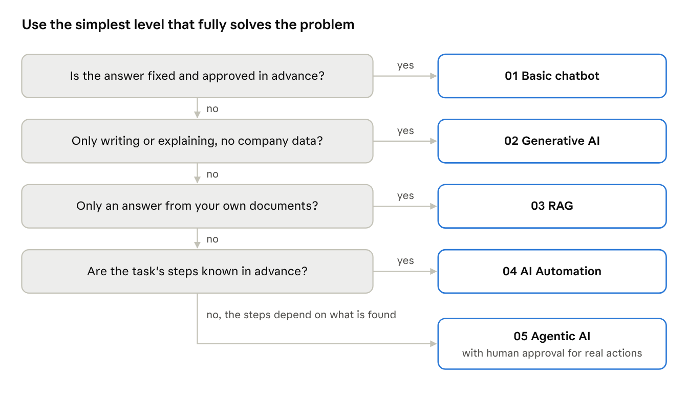

# PM004_05 Executive Summary: ChatBot - Basics to Advance

23 Nov 2026 · Naveen Nigam

ChatBot - Basics to Advance is a working app with five chatbots, one for each stage of AI evolution, that answer the same question side by side. It turns a common business question, "which kind of AI do we actually need?", into something people can see and test. The message it proves: more AI does not automatically mean better AI; start with the business requirement and choose the minimum capability needed.

| Item | Detail |
| --- | --- |
| What | One web app, five chatbots: Basic rules, Generative AI, RAG, AI Automation, Agentic AI |
| For whom | Business leaders, product and delivery teams, and people starting their AI journey |
| Built with | Python, FastAPI, SQLite, Anthropic Claude API, pytest, GitHub Actions |
| Status | Working prototype running live on Claude; 31 offline tests passing; capturing live results is the current step |
| Owner | Naveen Nigam (product owner, project manager and delivery lead) |
| Project documents | [PM004_01 Charter](PM004_01_Project_Charter.md), [PM004_04 Runbook](PM004_04_Runbook.md), [PM004_06 Workflows](PM004_06_Workflows.md), [PM004_07 Token Optimisation](PM004_07_Token_Optimisation.md) |

## 1. The problem

Organisations are under pressure to "use AI", but the options are blurred together and the most advanced one is often assumed to be the best.

- **Over-building:** an agent is proposed where a fixed FAQ or a simple workflow would do, adding cost, risk and testing effort.
- **Under-building:** a general chatbot is deployed for questions that depend on company policy, and it answers confidently but wrongly.
- **No shared language:** business, technology and risk teams use "chatbot", "GenAI", "RAG" and "agent" to mean different things, so decisions stall or go the wrong way.

What is missing is a simple, hands-on way to see what each level does differently before money is committed.

## 2. What was built

One app where the same question can be put to five chatbots; each level keeps what the previous one could do and adds one capability.

| # | Level | Adds | In one line |
| --- | --- | --- | --- |
| 01 | Basic chatbot | Rules | Exact, approved answers to known questions; never guesses |
| 02 | Generative AI | Generation | Understands free text and writes, but knows nothing about your company |
| 03 | RAG | Your knowledge | Answers only from your own documents and names the source |
| 04 | AI Automation | Actions | Carries out defined tasks through tools, such as raising a ticket |
| 05 | Agentic AI | Goal-driven steps | Plans, looks things up, decides whether to act from what it finds, verifies against the goal; asks before anything irreversible |

Every conversation is saved, demo tools never touch real systems, and a test suite checks each level's safety rules on every change.

## 3. Business cases by level

Each level pays off for a different kind of problem. The business cases below are illustrative and show where the value comes from and which measure it moves.

| Level | Typical business case | Where the value comes from | Measure it moves |
| --- | --- | --- | --- |
| 01 Basic | Bank FAQ: branch hours, payment cut-off times, card blocking menu | High-volume, identical questions answered instantly with approved wording | Contact-centre calls deflected; cost per contact |
| 01 Basic | IT service desk password-reset and login FAQ | Removes repetitive tickets at almost no running cost | Ticket volume; time to resolve |
| 02 Generative AI | Drafting status updates, client replies and leave requests | Writing time saved across every employee | Time per document; turnaround time |
| 02 Generative AI | Summarising long email threads and meeting notes | Faster decisions from less reading | Time to brief a manager |
| 03 RAG | HR and policy assistant that cites the policy it used | Consistent, current answers without asking HR | HR queries handled; answer accuracy |
| 03 RAG | Payments operations SOP assistant: "what do we check for a returned SWIFT payment?" | New analysts follow the team's own procedure, not guesswork | Time to competence; handling errors |
| 03 RAG | Contact-centre product terms: fees, limits, eligibility | Agents quote approved terms with the source | First-contact resolution; complaints |
| 04 AI Automation | Raise a service desk ticket from a chat description | Complete, well-formed tickets with no re-keying | Ticket quality; triage time |
| 04 AI Automation | Payment status lookup by reference | Instant answer from the system of record | Status queries handled; wait time |
| 04 AI Automation | Weekly production support report from ticket data | Hours of manual compilation removed every week | Hours per report |
| 05 Agentic AI | Incident support: gather alerts, check recent changes, suggest next steps, draft updates for approval | Faster diagnosis when the next step depends on each finding | Mean time to resolve; update timeliness |
| 05 Agentic AI | Reconciliation break investigation across systems | Open-ended investigation done in minutes, reviewed by a person | Breaks cleared per day; ageing |
| 05 Agentic AI | Weekly issue review: find high-priority unresolved issues, summarise root causes, draft the email | One request replaces several manual steps across tools | Analyst hours; time to insight |

The same organisation usually needs several levels at once: a bank may run a Basic FAQ, a RAG policy assistant and an automated ticketing flow, and reserve agents for a few high-value investigations.

### Reuse for internal employees

**The same bot can be rebuilt or integrated for internal employees.** Bluewater Bank's customers are the demo audience, but the five-level design works just as well as an employee assistant: pointed at internal HR and policy documents and internal systems, it lets staff check leave and other policies and send out emails.

| Level | For employees, it would… |
| --- | --- |
| 01 Basic | Answer fixed HR and IT FAQs: holidays, office hours, how to request leave |
| 02 Generative AI | Help draft emails, messages and summaries |
| 03 RAG | Answer leave, travel, expense and IT policy questions from the company's own policies, with the policy cited |
| 04 AI Automation | Check a leave balance, raise an HR or IT ticket, draft an email to a manager for review |
| 05 Agentic AI | Handle goals such as "Plan two days off next week and draft the request": check balance, notice rule and team calendar, then ask the employee to approve before anything is sent |

The demo already contains the employee side as mock tools (leave balance, leave policy, email drafts), so moving to internal use means swapping in the company's documents and connecting the HR system, ticketing tool and email, behind company sign-in, with human approval kept before anything is sent or submitted.

## 4. How to choose

Use the simplest level that fully solves the problem, and move up only when the level below cannot do the job.

| Mistake | What it costs |
| --- | --- |
| Choosing a level too high | Higher running cost, harder testing, more risk controls, slower delivery |
| Choosing a level too low | Wrong or unhelpful answers, manual work stays, users lose trust |

## 5. Status and next steps

The prototype runs live on Claude and passes 31 offline tests; capturing live results across all five levels is the current step.

**Done (Phase 0, 22 to 23 Nov 2026)**
- All five levels implemented in one app on the Anthropic Claude API, with saved conversation history, and running live
- Same topics and questions in every bot, so levels can be compared like for like
- Human approval before anything irreversible (blocking a card), in Automation and Agentic modes
- Agentic level rebuilt as Plan, Act (look first, then decide), Verify, with a plain-language note on why an agent was or was not needed
- Token use measured on every answer, with a token optimisation guide for future projects
- Offline test suite of 31 tests, covering every level and its safety rules, run on every change
- Project charter, runbook, workflows, token optimisation guide, architecture, decision guide and roadmap published

**Next**
- Phase 1 (in progress): run one scenario set through all five levels with the live API and record the results
- Phase 2: make levels 04 and 05 use Claude's native tool calling and strengthen retrieval for level 03
- Phase 3: publish the learning module (deck, runbook, examples)
- Phase 4: share a recorded demo

Results (accuracy, groundedness, response time and cost per answer for each level) will be added after Phase 1; none are claimed before they are measured.

## 6. My role and what this project shows

I owned the project end to end: problem framing, scope, design choices, delivery plan, documentation and quality checks, using Claude as a build assistant.

| Skill | Where it shows |
| --- | --- |
| Product thinking | Started from the business question, not the technology; MVP and backlog kept separate |
| AI solution judgement | Decision guide and business cases: the right level for each problem, and the cost of getting it wrong |
| Delivery discipline | Charter, phases with gates, risk register, runbook, changelog (PMP-style) |
| Responsible AI | Mock tools, allow-lists, human approval before real actions, no real data, secrets kept out of code |
| Quality | Automated tests for every level and its safety rules, run on every change |
| Communication | One-page summary, diagrams and a demo script for non-technical audiences |
