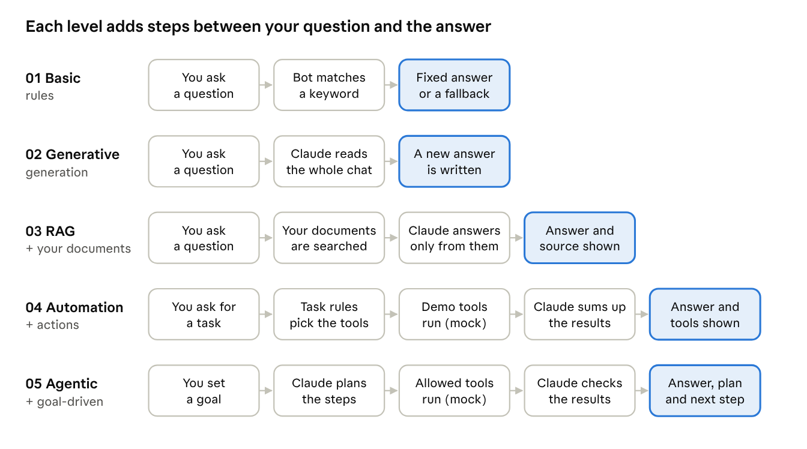
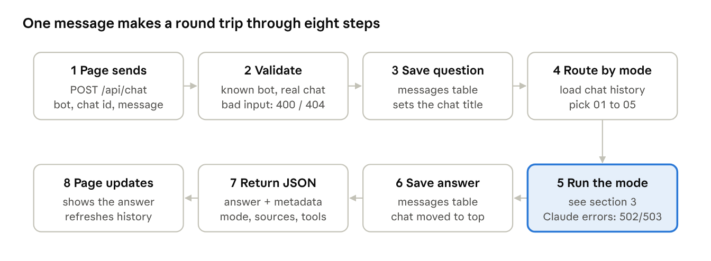
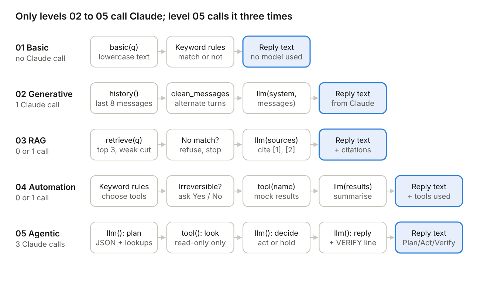

# PM004_06 Workflows: ChatBot - Basics to Advance

23 Nov 2026 · Naveen Nigam

This document shows how the five chatbots work twice over: first as the user experiences them (functional), then as the system processes them (technical). Every step matches the current code; anything planned is marked as backlog. Related: [Charter](PM004_01_Project_Charter.md), [Runbook](PM004_04_Runbook.md), [Executive Summary](PM004_05_Executive_Summary.md).

## 1. Functional workflows

From the user's side every level starts the same way: the same five topics, or a typed question or goal. Each level adds steps before the answer arrives, and every answer ends with follow-up buttons and Main menu (fixed in 01 and 04; suggested by Claude in 02, 03 and 05, written in the same call at no extra cost).

The highlighted box is what the user gets back. What changes from level to level is how much the bot does on the user's behalf, and how much it shows about how it got there.

| Level | User does | User sees | User can trust it for |
| --- | --- | --- | --- |
| 01 Basic | Clicks a topic or asks a known question | A fixed answer with buttons for the next questions, or the main menu if nothing matches | Exact, approved wording |
| 02 Generative AI | Picks a topic or asks anything in their own words | A new written answer, three suggested follow-up questions and Main menu | Drafting and explaining; not company facts |
| 03 RAG | Asks about company policy or procedure | An answer with numbered citations and a Sources list (document title and the passage used) | Answers grounded in the documents given |
| 04 AI Automation | Asks for a known task | A summary plus the tools that ran; a Yes / No approval first for anything irreversible; follow-ups offer only real tasks on the same topic; a cited document search when no rule matches | Defined tasks with predictable steps |
| 05 Agentic AI | States a goal, or picks a gold goal | A short reply, then Plan → Act → Verify steps and a "Why an agent here" note; a Yes / No approval first for anything irreversible | Multi-step goals, with a person approving any real action |

**The same bot can be rebuilt or integrated for internal employees.** Bluewater Bank's customers are the demo audience, but the five-level design works just as well as an employee assistant: pointed at internal HR and policy documents and internal systems, it lets staff check leave and other policies and send out emails.

| Level | For employees, it would… |
| --- | --- |
| 01 Basic | Answer fixed HR and IT FAQs: holidays, office hours, how to request leave |
| 02 Generative AI | Help draft emails, messages and summaries |
| 03 RAG | Answer leave, travel, expense and IT policy questions from the company's own policies, with the policy cited |
| 04 AI Automation | Check a leave balance, raise an HR or IT ticket, draft an email to a manager for review |
| 05 Agentic AI | Handle goals such as "Plan two days off next week and draft the request": check balance, notice rule and team calendar, then ask the employee to approve before anything is sent |

The demo already contains the employee side as mock tools (leave balance, leave policy, email drafts), so moving to internal use means swapping in the company's documents and connecting the HR system, ticketing tool and email, behind company sign-in, with human approval kept before anything is sent or submitted.

## 2. Technical request flow

Every message, whichever level it goes to, follows the same eight steps; only step 5 differs between levels.

The question is saved before the mode runs, so a failed request never loses what the user typed. Step 5 is broken down per level in section 3.

## 3. Technical workflow per level

Step 5 runs different functions in `app.py` for each level. The number of Claude calls is the clearest measure of how much each level costs and how hard it is to test.

| Level | Key functions | Claude calls per message | Backlog upgrade |
| --- | --- | --- | --- |
| 01 Basic | `basic()` over `BASIC_TREE` (16 topics, each with follow-up options) | 0 | None needed |
| 02 Generative AI | `history()`, `clean_messages()`, `llm()` | 1 | None needed |
| 03 RAG | `retrieve()` (content-word overlap, common words ignored, top 3 chunks, weak matches below half the best score dropped), `number_sources()`, `llm()` with numbered sources as context | 0 when nothing matches, else 1 | Embedding search with a vector store |
| 04 AI Automation | keyword rules (`automation_tools()`), `tool()`, `llm()` to summarise; no rule matched: cited document search; `NEEDS_APPROVAL` holds irreversible tools | 0 or 1 (0 when asking for approval, after a No, or when nothing is found) | Claude native tool calling |
| 05 Agentic AI | Plan: `llm()` JSON plan and read-only lookups (`READ_ONLY_TOOLS`). Act: `tool()`, then `llm()` decides actions after seeing the results (`ACTION_TOOLS`; irreversible ones held for approval). Verify: app checks, then `llm()` short reply with a `VERIFY:` line, parsed by `finish_verify()` | 3 | Native tool calling in a loop, with a human approval step |

## 4. Error and safety paths

Every failure returns a clear message instead of a guess, and the safety rules are enforced in code and covered by tests.

| Situation | What the system does | What the user sees | Tested |
| --- | --- | --- | --- |
| No API key configured | Stops before calling Claude (HTTP 400) | "No API key is set" plus where to add it | Yes |
| Key rejected (401) | Explains and marks the connection as failed; badge turns red | "Anthropic rejected the API key" plus the fix and an Open Settings button | Yes |
| Missing workspace ID or no credit | Explains the cause | The exact fix (workspace ID in Settings; add credit in Billing) | Yes |
| Model unavailable, rate limit, Anthropic busy | Explains the cause | What to do next | No |
| No internet | Catches the connection error (HTTP 502) | "Could not reach Anthropic" | Yes |
| A request failed, then the user sends again | Merges the two user turns so Claude still gets alternating turns | A normal answer | Yes |
| RAG finds nothing relevant | Does not call Claude at all | "I won't invent a policy answer" | Yes |
| Agent plans a tool that is not on the allow-list | Skips it; only allow-listed tools run | Only real demo tool results | Yes |
| Agent plan is not valid JSON | Falls back to a safe plan that only searches the documents | A normal answer from the documents | No |
| Agent decision is not valid JSON | Takes no action | "The agent's decision could not be read, so it safely took no action"; the raw reply is shown in the panel | Yes (parser test) |
| Agent tries an action during the look step | Blocks it; actions run only after the decision step | Listed under blocked tools | Yes |
| Document search finds only weak matches | Drops passages scoring less than half the best match | Answers use only relevant passages | Yes |
| Conversation belongs to another bot | Rejects the message (HTTP 400) | Error message | No |
| Empty message or unknown bot | Rejects the message (HTTP 400) | Error message | No |
| Any demo tool | Returns mock data only; nothing is sent, submitted or booked | Results marked as demo or "not sent" | Yes |
| An irreversible action is chosen (block_card), by rules (04) or by the agent's plan (05) | Holds it and asks for approval; other safe steps still run | "Please confirm…" with **Yes** / **No** buttons | Yes |
| User declines the action | Runs nothing and makes no Claude call | "Nothing was changed" | Yes |

**Guardrails at a glance.** These are the controls that keep a live AI system safe, grounded and affordable.

| Type | Guardrail in this app |
| --- | --- |
| Input | Message length limit on the public demo; empty messages and unknown bots rejected |
| Grounding | RAG answers only from retrieved passages, cites each one, and refuses when nothing relevant is found; weak matches are dropped |
| Action | Tool allow-list; read-only tools run first and actions only after the decision step; Yes / No approval before anything irreversible; a No runs nothing |
| Safe failure | If the agent's plan or decision cannot be read, it takes no action and shows the raw reply |
| Scope | The agent may not widen the user's goal or raise tickets the documents already answer |
| Cost and abuse | Daily caps on Claude calls (whole app and per visitor), history cap, output token caps |
| Security and privacy | API key only on the server; Settings locked on the public demo; each visitor sees only their own chats; demo data and mock tools only |
| Transparency | "What this level did" shows sources, tools, decision, checks and cost for every answer |

**Not built yet (next for any live use):** prompt-injection checks on document text, masking of personal data before it reaches the model, moderation of inputs and outputs, and an automated evaluation set.

## 5. Interfaces and data

The page talks to eleven small API endpoints, and two SQLite tables hold all conversations.

| Endpoint | Purpose |
| --- | --- |
| `GET /` | Serves the web page |
| `GET /api/health` | Status badge: provider, model, whether a key is configured |
| `GET /api/basic/menu` | Main menu topics for the Basic bot |
| `GET /api/menu?bot=<mode>` | The shared topic menu: in Basic each topic opens its menu branch; in 02 to 05 each topic opens the same list of questions; in 05 each topic also has a gold goal, plus three goals for the strip above the message box |
| `GET /api/settings` | Whether a key is set (masked hint only), workspace ID, model |
| `POST /api/settings` | Saves key, workspace ID and model to `.env`; validates their format |
| `POST /api/settings/test` | Live, free connection test (token count) with a plain-English result |
| `GET /api/conversations?bot=<mode>` | Lists saved conversations for one mode, newest first |
| `POST /api/conversations` | Starts a new conversation for a mode |
| `GET /api/conversations/{id}` | Reopens one conversation with all its messages |
| `POST /api/chat` | Sends a message and returns the answer plus metadata (mode, sources, tools, plan, workflow, verify, usage) |

| Table | Fields | Notes |
| --- | --- | --- |
| `conversations` | id, bot, title, created_at, updated_at | Title is the first 40 characters of the first question |
| `messages` | id, conversation_id, role, content, created_at, meta | Role is user or assistant; meta holds "what this level did" (sources, tools, plan, workflow, checks, token usage); only the last 8 messages are sent to Claude on each turn |

**Not stored in the database:** the API key. It is kept only in `.env` on the computer running the app and never returned to the page in full.
